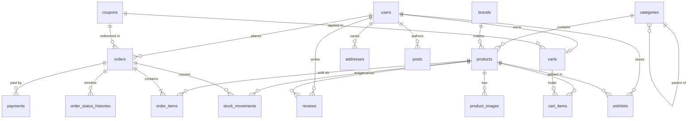

# Database schema

MySQL 8 · InnoDB · `utf8mb4`. Migrations live in `database/migrations`; run `php artisan migrate`.

## Conventions

- **Money** is stored as unsigned integers in minor units (cents) and cast to a `Money` value object.
- **Enums** (`orders.status`, `payments.status`, `users.role`, …) are stored as short strings and cast to PHP backed enums.
- **Snapshots**: `order_items` and `orders` copy product name, SKU, price and shipping address, so history survives catalogue edits and deletions.
- **Soft deletes** are used for `products` only (archived products stay referenced by orders).
- Foreign keys: customer-owned data cascades with the user; `orders.user_id` and `reviews.user_id` are nulled so history outlives an account; categories refuse deletion while they have children.
- Hot paths are indexed (`products(is_active, category_id)`, price, rating, sales, slug/sku uniques, `orders(user_id, placed_at)`, `payments(gateway, reference)` unique).

## Entity relationships

## Required tables from the specification

| Spec table | Table(s)                                          |
| ---------- | ------------------------------------------------- |
| users      | `users` (+ `addresses`, `passkeys`)               |
| products   | `products`, `product_images`, `brands`            |
| categories | `categories`                                      |
| orders     | `orders`, `order_items`, `order_status_histories` |
| cart       | `carts`, `cart_items`                             |
| wishlist   | `wishlists`                                       |
| payments   | `payments`                                        |
| reviews    | `reviews`                                         |

Extras: `coupons`, `stock_movements`, `posts`, `faqs`, `contact_messages`, plus framework tables (`sessions`, `cache`, `jobs`, …).

## Table reference (generated from the live schema)

### `posts`

| Column           | Type            | Null |
| ---------------- | --------------- | ---- |
| id               | bigint unsigned |      |
| author_id        | bigint unsigned | yes  |
| title            | varchar(255)    |      |
| slug             | varchar(255)    |      |
| excerpt          | varchar(500)    | yes  |
| body             | longtext        |      |
| cover_image_path | varchar(255)    | yes  |
| published_at     | timestamp       | yes  |
| meta_title       | varchar(255)    | yes  |
| meta_description | varchar(500)    | yes  |
| created_at       | timestamp       | yes  |
| updated_at       | timestamp       | yes  |

### `users`

| Column                    | Type            | Null |
| ------------------------- | --------------- | ---- |
| id                        | bigint unsigned |      |
| name                      | varchar(255)    |      |
| email                     | varchar(255)    |      |
| phone                     | varchar(32)     | yes  |
| avatar_path               | varchar(255)    | yes  |
| email_verified_at         | timestamp       | yes  |
| password                  | varchar(255)    |      |
| role                      | varchar(20)     |      |
| is_active                 | tinyint(1)      |      |
| two_factor_secret         | text            | yes  |
| two_factor_recovery_codes | text            | yes  |
| two_factor_confirmed_at   | timestamp       | yes  |
| remember_token            | varchar(100)    | yes  |
| last_login_at             | timestamp       | yes  |
| created_at                | timestamp       | yes  |
| updated_at                | timestamp       | yes  |

### `addresses`

| Column      | Type            | Null |
| ----------- | --------------- | ---- |
| id          | bigint unsigned |      |
| user_id     | bigint unsigned |      |
| label       | varchar(50)     | yes  |
| full_name   | varchar(120)    |      |
| phone       | varchar(32)     |      |
| line1       | varchar(255)    |      |
| line2       | varchar(255)    | yes  |
| city        | varchar(100)    |      |
| state       | varchar(100)    | yes  |
| postal_code | varchar(20)     |      |
| country     | char(2)         |      |
| is_default  | tinyint(1)      |      |
| created_at  | timestamp       | yes  |
| updated_at  | timestamp       | yes  |

### `brands`

| Column      | Type            | Null |
| ----------- | --------------- | ---- |
| id          | bigint unsigned |      |
| name        | varchar(120)    |      |
| slug        | varchar(140)    |      |
| description | varchar(500)    | yes  |
| is_active   | tinyint(1)      |      |
| created_at  | timestamp       | yes  |
| updated_at  | timestamp       | yes  |

### `cart_items`

| Column     | Type            | Null |
| ---------- | --------------- | ---- |
| id         | bigint unsigned |      |
| cart_id    | bigint unsigned |      |
| product_id | bigint unsigned |      |
| quantity   | int unsigned    |      |
| created_at | timestamp       | yes  |
| updated_at | timestamp       | yes  |

### `carts`

| Column     | Type            | Null |
| ---------- | --------------- | ---- |
| id         | bigint unsigned |      |
| user_id    | bigint unsigned | yes  |
| token      | varchar(64)     | yes  |
| coupon_id  | bigint unsigned | yes  |
| created_at | timestamp       | yes  |
| updated_at | timestamp       | yes  |

### `categories`

| Column           | Type            | Null |
| ---------------- | --------------- | ---- |
| id               | bigint unsigned |      |
| parent_id        | bigint unsigned | yes  |
| name             | varchar(120)    |      |
| slug             | varchar(140)    |      |
| description      | text            | yes  |
| image_path       | varchar(255)    | yes  |
| is_active        | tinyint(1)      |      |
| position         | int unsigned    |      |
| meta_title       | varchar(255)    | yes  |
| meta_description | varchar(500)    | yes  |
| created_at       | timestamp       | yes  |
| updated_at       | timestamp       | yes  |

### `contact_messages`

| Column     | Type            | Null |
| ---------- | --------------- | ---- |
| id         | bigint unsigned |      |
| user_id    | bigint unsigned | yes  |
| name       | varchar(120)    |      |
| email      | varchar(255)    |      |
| phone      | varchar(32)     | yes  |
| subject    | varchar(150)    |      |
| message    | text            |      |
| ip_address | varchar(45)     | yes  |
| read_at    | timestamp       | yes  |
| created_at | timestamp       | yes  |
| updated_at | timestamp       | yes  |

### `coupons`

| Column               | Type            | Null |
| -------------------- | --------------- | ---- |
| id                   | bigint unsigned |      |
| code                 | varchar(40)     |      |
| description          | varchar(255)    | yes  |
| type                 | varchar(20)     |      |
| value                | bigint unsigned |      |
| max_discount         | bigint unsigned | yes  |
| min_subtotal         | bigint unsigned | yes  |
| usage_limit          | int unsigned    | yes  |
| usage_limit_per_user | int unsigned    | yes  |
| times_used           | int unsigned    |      |
| starts_at            | timestamp       | yes  |
| expires_at           | timestamp       | yes  |
| is_active            | tinyint(1)      |      |
| created_at           | timestamp       | yes  |
| updated_at           | timestamp       | yes  |

### `faqs`

| Column       | Type            | Null |
| ------------ | --------------- | ---- |
| id           | bigint unsigned |      |
| topic        | varchar(60)     |      |
| question     | varchar(255)    |      |
| answer       | text            |      |
| position     | int unsigned    |      |
| is_published | tinyint(1)      |      |
| created_at   | timestamp       | yes  |
| updated_at   | timestamp       | yes  |

### `order_items`

| Column        | Type            | Null |
| ------------- | --------------- | ---- |
| id            | bigint unsigned |      |
| order_id      | bigint unsigned |      |
| product_id    | bigint unsigned | yes  |
| product_name  | varchar(255)    |      |
| product_sku   | varchar(64)     |      |
| product_image | varchar(255)    | yes  |
| unit_price    | bigint unsigned |      |
| quantity      | int unsigned    |      |
| line_total    | bigint unsigned |      |
| created_at    | timestamp       | yes  |
| updated_at    | timestamp       | yes  |

### `order_status_histories`

| Column      | Type            | Null |
| ----------- | --------------- | ---- |
| id          | bigint unsigned |      |
| order_id    | bigint unsigned |      |
| user_id     | bigint unsigned | yes  |
| from_status | varchar(20)     | yes  |
| to_status   | varchar(20)     |      |
| note        | varchar(500)    | yes  |
| created_at  | timestamp       |      |

### `orders`

| Column               | Type            | Null |
| -------------------- | --------------- | ---- |
| id                   | bigint unsigned |      |
| number               | varchar(32)     |      |
| user_id              | bigint unsigned | yes  |
| coupon_id            | bigint unsigned | yes  |
| status               | varchar(20)     |      |
| payment_status       | varchar(20)     |      |
| payment_method       | varchar(20)     |      |
| currency             | char(3)         |      |
| subtotal             | bigint unsigned |      |
| discount_total       | bigint unsigned |      |
| shipping_total       | bigint unsigned |      |
| tax_total            | bigint unsigned |      |
| grand_total          | bigint unsigned |      |
| coupon_code          | varchar(40)     | yes  |
| customer_email       | varchar(255)    |      |
| shipping_name        | varchar(120)    |      |
| shipping_phone       | varchar(32)     |      |
| shipping_line1       | varchar(255)    |      |
| shipping_line2       | varchar(255)    | yes  |
| shipping_city        | varchar(100)    |      |
| shipping_state       | varchar(100)    | yes  |
| shipping_postal_code | varchar(20)     |      |
| shipping_country     | char(2)         |      |
| notes                | text            | yes  |
| cancellation_reason  | varchar(255)    | yes  |
| placed_at            | timestamp       |      |
| paid_at              | timestamp       | yes  |
| shipped_at           | timestamp       | yes  |
| delivered_at         | timestamp       | yes  |
| cancelled_at         | timestamp       | yes  |
| created_at           | timestamp       | yes  |
| updated_at           | timestamp       | yes  |

### `passkeys`

| Column        | Type            | Null |
| ------------- | --------------- | ---- |
| id            | bigint unsigned |      |
| user_id       | bigint unsigned |      |
| name          | varchar(255)    |      |
| credential_id | varchar(255)    |      |
| credential    | json            |      |
| last_used_at  | timestamp       | yes  |
| created_at    | timestamp       | yes  |
| updated_at    | timestamp       | yes  |

### `payments`

| Column         | Type            | Null |
| -------------- | --------------- | ---- |
| id             | bigint unsigned |      |
| order_id       | bigint unsigned |      |
| gateway        | varchar(20)     |      |
| status         | varchar(20)     |      |
| amount         | bigint unsigned |      |
| currency       | char(3)         |      |
| reference      | varchar(255)    | yes  |
| payload        | json            | yes  |
| failure_reason | varchar(500)    | yes  |
| paid_at        | timestamp       | yes  |
| created_at     | timestamp       | yes  |
| updated_at     | timestamp       | yes  |

### `product_images`

| Column         | Type            | Null |
| -------------- | --------------- | ---- |
| id             | bigint unsigned |      |
| product_id     | bigint unsigned |      |
| path           | varchar(255)    |      |
| thumbnail_path | varchar(255)    | yes  |
| alt            | varchar(255)    | yes  |
| position       | int unsigned    |      |
| created_at     | timestamp       | yes  |
| updated_at     | timestamp       | yes  |

### `products`

| Column              | Type            | Null |
| ------------------- | --------------- | ---- |
| id                  | bigint unsigned |      |
| category_id         | bigint unsigned |      |
| brand_id            | bigint unsigned | yes  |
| name                | varchar(255)    |      |
| slug                | varchar(255)    |      |
| sku                 | varchar(64)     |      |
| short_description   | varchar(500)    | yes  |
| description         | text            | yes  |
| price               | bigint unsigned |      |
| compare_at_price    | bigint unsigned | yes  |
| stock_quantity      | int unsigned    |      |
| low_stock_threshold | int unsigned    |      |
| is_active           | tinyint(1)      |      |
| is_featured         | tinyint(1)      |      |
| rating_average      | decimal(3,2)    |      |
| reviews_count       | int unsigned    |      |
| sales_count         | int unsigned    |      |
| meta_title          | varchar(255)    | yes  |
| meta_description    | varchar(500)    | yes  |
| created_at          | timestamp       | yes  |
| updated_at          | timestamp       | yes  |
| deleted_at          | timestamp       | yes  |

### `reviews`

| Column               | Type             | Null |
| -------------------- | ---------------- | ---- |
| id                   | bigint unsigned  |      |
| product_id           | bigint unsigned  |      |
| user_id              | bigint unsigned  | yes  |
| rating               | tinyint unsigned |      |
| title                | varchar(150)     | yes  |
| body                 | text             |      |
| is_approved          | tinyint(1)       |      |
| is_verified_purchase | tinyint(1)       |      |
| created_at           | timestamp        | yes  |
| updated_at           | timestamp        | yes  |

### `stock_movements`

| Column        | Type            | Null |
| ------------- | --------------- | ---- |
| id            | bigint unsigned |      |
| product_id    | bigint unsigned |      |
| order_id      | bigint unsigned | yes  |
| user_id       | bigint unsigned | yes  |
| type          | varchar(20)     |      |
| quantity      | int             |      |
| balance_after | int unsigned    |      |
| note          | varchar(255)    | yes  |
| created_at    | timestamp       |      |

### `wishlists`

| Column     | Type            | Null |
| ---------- | --------------- | ---- |
| id         | bigint unsigned |      |
| user_id    | bigint unsigned |      |
| product_id | bigint unsigned |      |
| created_at | timestamp       | yes  |
| updated_at | timestamp       | yes  |

### `attachments`

| Column | Type | Null |
| ------ | ---- | ---- |

### `category_insight`

| Column | Type | Null |
| ------ | ---- | ---- |

### `category_project`

| Column | Type | Null |
| ------ | ---- | ---- |

### `contact_inquiries`

| Column | Type | Null |
| ------ | ---- | ---- |

### `google_reviews`

| Column | Type | Null |
| ------ | ---- | ---- |

### `insights`

| Column | Type | Null |
| ------ | ---- | ---- |

### `projects`

| Column | Type | Null |
| ------ | ---- | ---- |

### `role_permissions`

| Column | Type | Null |
| ------ | ---- | ---- |

### `roles`

| Column | Type | Null |
| ------ | ---- | ---- |

### `services`

| Column | Type | Null |
| ------ | ---- | ---- |

### `settings`

| Column | Type | Null |
| ------ | ---- | ---- |

### `slug_redirects`

| Column | Type | Null |
| ------ | ---- | ---- |

### `user_roles`

| Column | Type | Null |
| ------ | ---- | ---- |

### `activity_log`

| Column | Type | Null |
| ------ | ---- | ---- |

### `agent_conversation_messages`

| Column | Type | Null |
| ------ | ---- | ---- |

### `agent_conversations`

| Column | Type | Null |
| ------ | ---- | ---- |

### `ai_estimation_materials`

| Column | Type | Null |
| ------ | ---- | ---- |

### `ai_estimations`

| Column | Type | Null |
| ------ | ---- | ---- |

### `cities`

| Column | Type | Null |
| ------ | ---- | ---- |

### `construction_template_materials`

| Column | Type | Null |
| ------ | ---- | ---- |

### `construction_templates`

| Column | Type | Null |
| ------ | ---- | ---- |

### `images`

| Column | Type | Null |
| ------ | ---- | ---- |

### `labor_categories`

| Column | Type | Null |
| ------ | ---- | ---- |

### `labor_rates`

| Column | Type | Null |
| ------ | ---- | ---- |

### `material_rates`

| Column | Type | Null |
| ------ | ---- | ---- |

### `materials`

| Column | Type | Null |
| ------ | ---- | ---- |

### `model_has_permissions`

| Column | Type | Null |
| ------ | ---- | ---- |

### `model_has_roles`

| Column | Type | Null |
| ------ | ---- | ---- |

### `permissions`

| Column | Type | Null |
| ------ | ---- | ---- |

### `plot_sizes`

| Column | Type | Null |
| ------ | ---- | ---- |

### `project_materials`

| Column | Type | Null |
| ------ | ---- | ---- |

### `role_has_permissions`

| Column | Type | Null |
| ------ | ---- | ---- |

### `user_companies`

| Column | Type | Null |
| ------ | ---- | ---- |

### `about_us`

| Column | Type | Null |
| ------ | ---- | ---- |

### `banners`

| Column | Type | Null |
| ------ | ---- | ---- |

### `blogs`

| Column | Type | Null |
| ------ | ---- | ---- |

### `blogs_categories`

| Column | Type | Null |
| ------ | ---- | ---- |

### `contact_us`

| Column | Type | Null |
| ------ | ---- | ---- |

### `customers`

| Column | Type | Null |
| ------ | ---- | ---- |

### `galleries`

| Column | Type | Null |
| ------ | ---- | ---- |

### `password_resets`

| Column | Type | Null |
| ------ | ---- | ---- |

### `personal_access_tokens`

| Column | Type | Null |
| ------ | ---- | ---- |

### `registrations`

| Column | Type | Null |
| ------ | ---- | ---- |

### `service_contacts`

| Column | Type | Null |
| ------ | ---- | ---- |

### `testimonials`

| Column | Type | Null |
| ------ | ---- | ---- |

### `visitors`

| Column | Type | Null |
| ------ | ---- | ---- |

### `blog_posts`

| Column | Type | Null |
| ------ | ---- | ---- |

### `booking_requests`

| Column | Type | Null |
| ------ | ---- | ---- |

### `content_blocks`

| Column | Type | Null |
| ------ | ---- | ---- |

### `course_instructors`

| Column | Type | Null |
| ------ | ---- | ---- |

### `course_reviews`

| Column | Type | Null |
| ------ | ---- | ---- |

### `courses`

| Column | Type | Null |
| ------ | ---- | ---- |

### `gallery_items`

| Column | Type | Null |
| ------ | ---- | ---- |

### `home_features`

| Column | Type | Null |
| ------ | ---- | ---- |

### `home_slides`

| Column | Type | Null |
| ------ | ---- | ---- |

### `not_found_logs`

| Column | Type | Null |
| ------ | ---- | ---- |

### `process_steps`

| Column | Type | Null |
| ------ | ---- | ---- |

### `redirects`

| Column | Type | Null |
| ------ | ---- | ---- |

### `seo_pages`

| Column | Type | Null |
| ------ | ---- | ---- |

### `staff_members`

| Column | Type | Null |
| ------ | ---- | ---- |

### `success_stories`

| Column | Type | Null |
| ------ | ---- | ---- |

### `best_services`

| Column | Type | Null |
| ------ | ---- | ---- |

### `career_applications`

| Column | Type | Null |
| ------ | ---- | ---- |

### `distributor_requests`

| Column | Type | Null |
| ------ | ---- | ---- |

### `featured_sections`

| Column | Type | Null |
| ------ | ---- | ---- |

### `hero_banners`

| Column | Type | Null |
| ------ | ---- | ---- |

### `legal_pages`

| Column | Type | Null |
| ------ | ---- | ---- |

### `media`

| Column | Type | Null |
| ------ | ---- | ---- |

### `newsletters`

| Column | Type | Null |
| ------ | ---- | ---- |

### `partners`

| Column | Type | Null |
| ------ | ---- | ---- |

### `product_sizes`

| Column | Type | Null |
| ------ | ---- | ---- |

### `promotion_sections`

| Column | Type | Null |
| ------ | ---- | ---- |

### `teams`

| Column | Type | Null |
| ------ | ---- | ---- |

### `advertisement_requests`

| Column | Type | Null |
| ------ | ---- | ---- |

### `board_member_descriptions`

| Column | Type | Null |
| ------ | ---- | ---- |

### `book_stalls`

| Column | Type | Null |
| ------ | ---- | ---- |

### `casting_materials`

| Column | Type | Null |
| ------ | ---- | ---- |

### `events`

| Column | Type | Null |
| ------ | ---- | ---- |

### `magazines`

| Column | Type | Null |
| ------ | ---- | ---- |

### `member_casting_materials`

| Column | Type | Null |
| ------ | ---- | ---- |

### `members`

| Column | Type | Null |
| ------ | ---- | ---- |

### `memberships`

| Column | Type | Null |
| ------ | ---- | ---- |

### `news`

| Column | Type | Null |
| ------ | ---- | ---- |

### `analytics_metrics`

| Column | Type | Null |
| ------ | ---- | ---- |

### `daily_event_stats`

| Column | Type | Null |
| ------ | ---- | ---- |

### `devices`

| Column | Type | Null |
| ------ | ---- | ---- |

### `playstore_crash_issues`

| Column | Type | Null |
| ------ | ---- | ---- |

### `playstore_dimensions`

| Column | Type | Null |
| ------ | ---- | ---- |

### `playstore_reviews`

| Column | Type | Null |
| ------ | ---- | ---- |

### `playstore_vitals`

| Column | Type | Null |
| ------ | ---- | ---- |

### `user_activities`

| Column | Type | Null |
| ------ | ---- | ---- |

### `audit_logs`

| Column | Type | Null |
| ------ | ---- | ---- |

### `colour_photos`

| Column | Type | Null |
| ------ | ---- | ---- |

### `designs`

| Column | Type | Null |
| ------ | ---- | ---- |

### `licenses`

| Column | Type | Null |
| ------ | ---- | ---- |

### `recipes`

| Column | Type | Null |
| ------ | ---- | ---- |

### `stocks`

| Column | Type | Null |
| ------ | ---- | ---- |

### `announcements`

| Column | Type | Null |
| ------ | ---- | ---- |

### `blocked_countries`

| Column | Type | Null |
| ------ | ---- | ---- |

### `contacts`

| Column | Type | Null |
| ------ | ---- | ---- |

### `conversations`

| Column | Type | Null |
| ------ | ---- | ---- |

### `coupon_product`

| Column | Type | Null |
| ------ | ---- | ---- |

### `coupon_user`

| Column | Type | Null |
| ------ | ---- | ---- |

### `couriers`

| Column | Type | Null |
| ------ | ---- | ---- |

### `medias`

| Column | Type | Null |
| ------ | ---- | ---- |

### `messages`

| Column | Type | Null |
| ------ | ---- | ---- |

### `newsletter_subscribers`

| Column | Type | Null |
| ------ | ---- | ---- |

### `notifications`

| Column | Type | Null |
| ------ | ---- | ---- |

### `payment_icons`

| Column | Type | Null |
| ------ | ---- | ---- |

### `payment_methods`

| Column | Type | Null |
| ------ | ---- | ---- |

### `payment_transactions`

| Column | Type | Null |
| ------ | ---- | ---- |

### `policy_pages`

| Column | Type | Null |
| ------ | ---- | ---- |

### `product_customer_prices`

| Column | Type | Null |
| ------ | ---- | ---- |

### `recently_viewed_products`

| Column | Type | Null |
| ------ | ---- | ---- |

### `sliders`

| Column | Type | Null |
| ------ | ---- | ---- |

### `store_follows`

| Column | Type | Null |
| ------ | ---- | ---- |

### `system_logs`

| Column | Type | Null |
| ------ | ---- | ---- |
